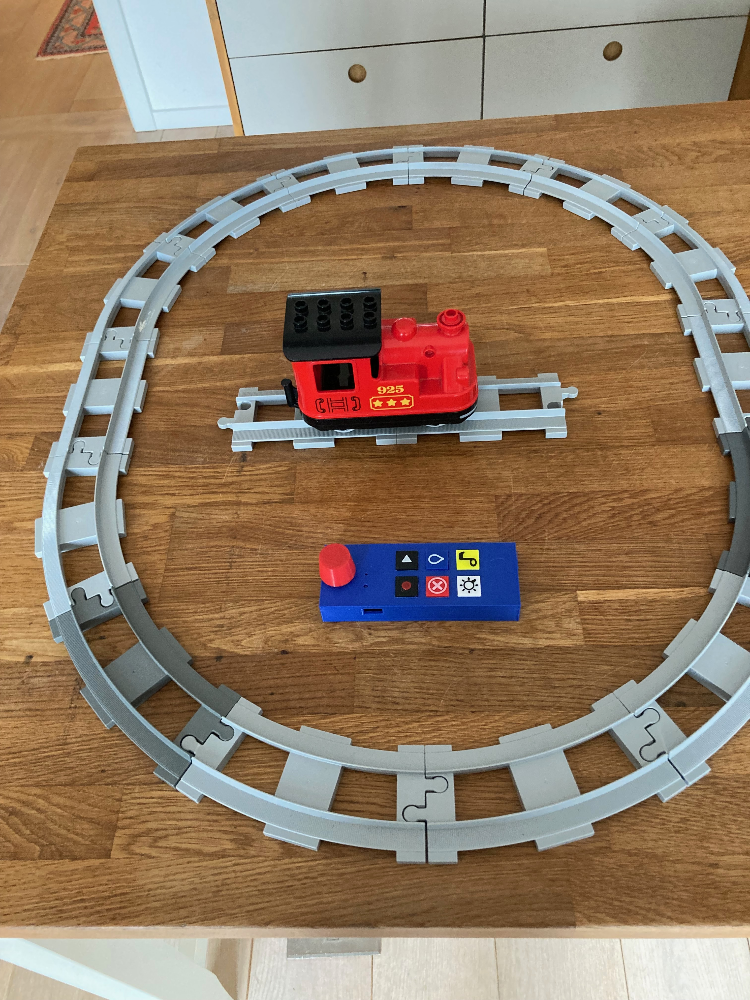
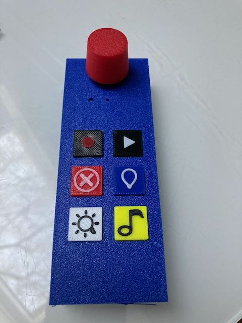

# DUPLO Train Controller NG

ESP32-S3-based handheld controller for LEGO DUPLO trains, implementing BLE communication, deterministic command handling, replay/record, sensor routing, and low-power sleep/wake behavior.

LEGO and DUPLO are trademarks and copyrighted properties of the LEGO Group. This project is an independent, community-driven development and is not affiliated with, authorized, endorsed, or sponsored by the LEGO Group.

## Overview

This repository contains the complete implementation package for the controller:

- firmware sources for application logic and BLE runtime
- schematic/PCB design files and manufacturing outputs
- OpenSCAD enclosure sources and 3D-print assets

The target hardware is an ESP32-S3 board with one RGB status LED, six front-panel buttons connected through an ADC resistor ladder, and one rotary encoder with push button.

At runtime, the firmware separates BLE processing from UI/control logic and uses queue-based cross-task communication. The resulting behavior is:

- non-blocking command flow during connect/reconnect phases
- explicit distinction between BLE link-up and application-ready state
- stable reconnect behavior after train power-cycle
- deterministic replay/record using fixed-size command buffering
- power management with controlled sleep entry and defined wake path

### Overview Demo Video

The short feature demonstration is available here:


[](images/Demo-Train-Controller.mov)


- [Duplo Train Controller demo video available on youtube](https://www.youtube.com/shorts/3SnFerBsN44)
  
### Hardware Gallery

#### Controller and PCB 3D View

<p align="center">
	
	
</p>

#### Schematic

<p align="center">
	
</p>

### Manufacturing Note

I have been using PCBWay for PCB manufacturing for many years and have consistently had a great experience with production quality, lead time, shipping reliability, and overall pricing.

For this controller revision, I also used the PCB assembly service. The result was especially positive: when I made a few minor part-selection mistakes in the BOM, PCBWay engineering proactively reached out, clarified the issues, and helped resolve everything quickly before production. For future, more complex designs, especially boards with a higher SMD component density, this assembly workflow is now my preferred path.

## Current Feature Status

Implemented features (high level):

- automatic BLE connection to the DUPLO train
- reconnect after train power-cycle in about 2 to 3 seconds in practice
- command acceptance immediately after reaching ready state
- thread-safe separation of UI logic and BLE communication
- record/replay of user interactions with timestamps
- sensor processing for color, speed, and voltage
- color sensor debouncing via stability timer
- sleep after 5 minutes of inactivity
- wake via encoder button, including RTC and GPIO fallback
- upload window only with intentional encoder hold during startup

## Status-LED

The controller LED indicates the current state as follows:

- Yellow blinking: controller is booting
- Blue blinking: BLE link is up, hub initialization still running
- Green blinking: hub is operational and commands can be executed
- Green occasional short pulses: operational and idle
- Violet blinking: recording active
- Yellow blinking: replay active
- Solid red: emergency stop active
- Red short blink sequence: train low-voltage warning
- White blinking: hub disconnected
- 5x green: wake from sleep confirmed
- 2x red: sleep entry indication

Important: Green now explicitly means not just "connected" but "ready for commands".

## Controls

- Rotate encoder: set speed reverse, stop, forward
- Short encoder press: wake from sleep
- Hold encoder during startup >= 2 s: open 10-second upload window
- REC: start/stop recording
- PLAY: play the latest recording once
- STOP: stop replay/recording and toggle emergency stop
- LIGHT: cycle train light colors
- SOUND: cycle sounds
- WATER: trigger water action

## Color Bricks

The following color bricks of the DUPLO Train are also recognized:
- Yellow: horn
- Red: stop train
- Green: stop and switch driving direction
- White: toggle light
- Blue: water action, then continue at previous speed

## Architecture in Short

- Core 0: BLE-Task (`DuploHub`)
- Core 1: Arduino-Loop (`TrainController`)
- Main Loop -> `commandQueue` -> BLE-Task
- BLE-Task -> `responseQueue` -> Main Loop

Details are documented in [ARCHITECTURE.md](ARCHITECTURE.md).

## Project Structure

- [src](src): project-owned implementation
- [include](include): project-owned headers
- [hardware](hardware): schematic, PCB, enclosure, and hardware docs
- [lib/Legoino](lib/Legoino): vendored Legoino library with project-specific adjustments
- [lib/NimBLE-Arduino](lib/NimBLE-Arduino): vendored BLE library

## Build

Main environment:

```bash
platformio run -e esp32-s3-fh4r2
```

Upload:

```bash
platformio run -e esp32-s3-fh4r2 --target upload
```

Serial monitor:

```bash
platformio device monitor --environment esp32-s3-fh4r2
```

Diagnostic environment for the ADC monitor:

```bash
platformio run -e esp32-s3-input-monitor
```

## Hardware Requirements

- ESP32-S3 board with RGB LED and USB-C charging
- 6 buttons on an ADC resistor ladder
- 1 rotary encoder with push button
- LEGO DUPLO train hub

## Implementation Details

- `TrainController.cpp` contains the full application logic, input processing, sleep/wake, and UI state.
- `DuploHub.cpp` encapsulates BLE lifecycle, queue processing, sensor routing, and replay/record.
- `myLegoHub.cpp` contains DUPLO-specific Legoino helper logic.
- Post-connect hub initialization runs non-blocking in the main loop so the BLE task is not blocked.
- Reconnect scans use a shorter search window, significantly reducing real-world reconnect time.

## Documentation

- [ARCHITECTURE.md](ARCHITECTURE.md): technical architecture and runtime model
- [User Manual.md](User%20Manual.md): user operating guide
- [hardware/Hardware.md](hardware/Hardware.md): hardware background
- [Kommunikation intern/Protokolle/Projekt-Tagesprotokoll.md](Kommunikation%20intern/Protokolle/Projekt-Tagesprotokoll.md): work log

## Open Topics

Currently most relevant:

- further facade consolidation through `myLegoHub`
- potential pairing/preference logic for a preferred train
- hardware-level controller battery monitoring

The detailed work list is in [ToDo.md](ToDo.md).
